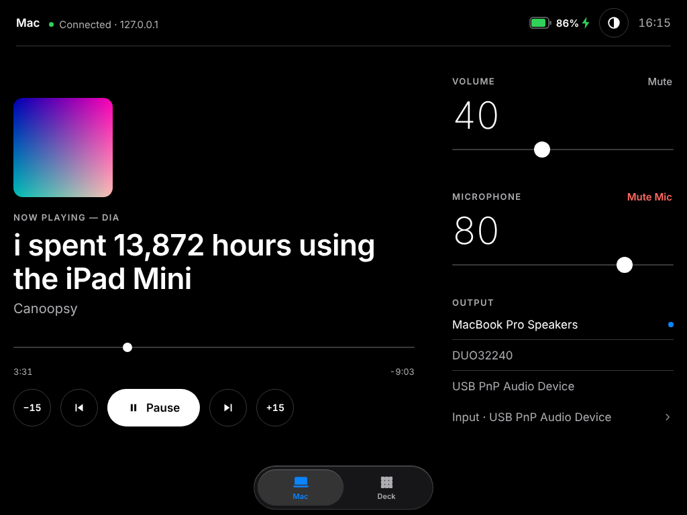
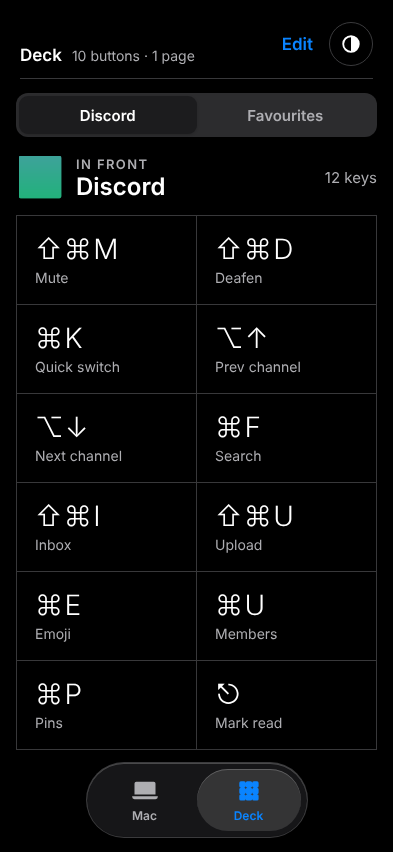

# Deckside

**Turn a spare iPad or phone into a control panel and Stream Deck for your Mac.**
Nothing to install on the iPad: it runs in Safari, so even an old iPad that no longer gets App Store updates works.

<p>
  
  
</p>

## What it does

**Mac**
- Now playing from any app (Music, Spotify, YouTube in the browser…) with artwork, seek, play/pause, next and ±15 s
- Volume and mute, microphone level and mute
- Switch sound output and input devices
- Battery level

**Deck**
- **In front**: buttons that change with the app you're using. Starter shortcuts are included for Safari, Chrome, Dia, Finder, Zoom, Slack, Discord, VS Code, Premiere Pro, Bitwarden and Claude.
- **Favourites**: open apps, run Shortcuts, open links, send key combos, or chain them into multi-step actions, on several pages
- Add and edit everything from the iPad (tap **Edit**)

It fills any screen with no scrolling (iPad landscape or portrait, phone, even a phone on its side), and has light (warm), dark and auto themes.

## Install

On the Mac, open **Terminal** and paste:

```bash
curl -fsSL https://raw.githubusercontent.com/aalharthi977/deckside/main/install.sh | bash
```

It takes about a minute. When it finishes it shows a **QR code**:

1. Scan it with the iPad or phone camera (it must be on the same Wi-Fi as the Mac).
2. In Safari, tap **Share → Add to Home Screen**. Deckside now opens full screen, like an app.

That's it. Deckside starts by itself whenever you log in to the Mac.

<details>
<summary>What the installer does</summary>

- Uses the Python that comes with Apple's Command Line Tools (it offers to install them if they're missing).
- Installs three small helpers with [Homebrew](https://brew.sh) (it offers to install Homebrew if needed):
  `media-control` (now playing and play/pause in any app on macOS 15.4+), `switchaudio-osx` (sound devices) and `qrencode` (the pairing code).
  Without Homebrew Deckside still works; those features are skipped.
- Copies the app to `~/.deckside`, creates a private access token, and adds a login item (`~/Library/LaunchAgents/com.deckside.server.plist`).
- Adds the `deckside` command.

Prefer to read it first? Download the repo, look through `install.sh`, then run `./install.sh` from the folder.
</details>

## Requirements

- A Mac with macOS 13 or later (developed on macOS 26 Tahoe)
- Any iPad, iPhone or Android device with a web browser, on the same network as the Mac

## Permissions (one time)

- **Keyboard-shortcut buttons**: the first time you tap one, macOS asks to let `python3` control **System Events**. Click **Allow**.
  If you clicked Don't Allow: System Settings → Privacy & Security → Automation → python3 → turn on System Events.
- **Firewall**: if macOS asks whether `python3` may accept incoming connections, click **Allow**.

## Commands

```text
deckside pair         show the link and QR code again (to add another iPad or phone)
deckside status       is it running?
deckside restart      restart it
deckside logs         follow the log
deckside new-token    make a new token (un-pairs every device)
deckside update       install the latest version (keeps your buttons and token)
deckside uninstall    remove Deckside (add --keep-settings to keep your buttons)
```

## Privacy and security

- Everything stays on your home network. There's no account and no cloud, and nothing is sent anywhere.
- Every request needs the token from the pairing link. Treat the link like a password; `deckside new-token` replaces it.
- The iPad can only press buttons you've saved. It can't run arbitrary commands: key combos come from a fixed list, links must be `http(s)`, and app switching only targets apps that are already running.
- Don't forward Deckside's port (8765) on your router. It's meant for your local network only.

## Settings

- **Hide sound devices** you never use (virtual devices, meeting apps): edit `~/.deckside/config.json`:
  ```json
  { "hide_devices": ["BlackHole", "ZoomAudioDevice", "Microsoft Teams Audio"] }
  ```
  Changes apply right away.
- **Another port**: `DECKSIDE_PORT=8766 bash install.sh`, then `deckside pair` for the new link.
- Your buttons are saved in `~/.deckside/deck.json`.

## Troubleshooting

| Problem | Fix |
| --- | --- |
| The link with `.local` doesn't load | Some routers and mesh/guest networks block Mac names. Use the IP link that `deckside pair` also prints. |
| "Can't reach the Mac" | Check both devices are on the same Wi-Fi, then `deckside status`. If the Mac was asleep, wake it. |
| Shortcut buttons do nothing | Allow `python3` → System Events (see Permissions). Some apps ignore keys while a dialog is open. |
| Play/pause doesn't work in the browser or other apps | Run `brew install media-control`, then `deckside restart`. |
| No sound output list | Run `brew install switchaudio-osx`, then `deckside restart`. |
| Asked for a token | Scan the QR code again, or run `deckside pair` on the Mac. |

## Uninstall

```bash
deckside uninstall
```

This removes the login item, the `deckside` command and `~/.deckside`. The Homebrew helpers stay installed; remove them with `brew uninstall media-control switchaudio-osx qrencode`.

## How it works

A small Python server (standard library only) runs on the Mac as a login item. It serves the panel to your iPad's browser and controls the Mac with built-in tools (`osascript`, `lsappinfo`, `pmset`, `shortcuts`) plus the optional helpers above.

```text
app/server.py                the server and API
app/panel/index.html         the whole panel (HTML, CSS, JS in one file)
app/starter_profiles.json    starter "in front" shortcuts per app
install.sh · uninstall.sh · deckside (the command)
```

**Add shortcuts for an app:** add its bundle id (find it with `osascript -e 'id of app "AppName"'`) and buttons to `app/starter_profiles.json`, then open a pull request.

## License

MIT. See [LICENSE](LICENSE).
